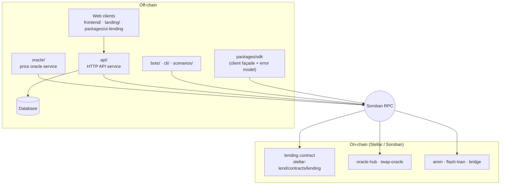
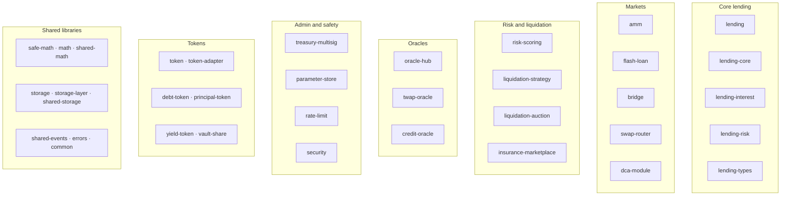
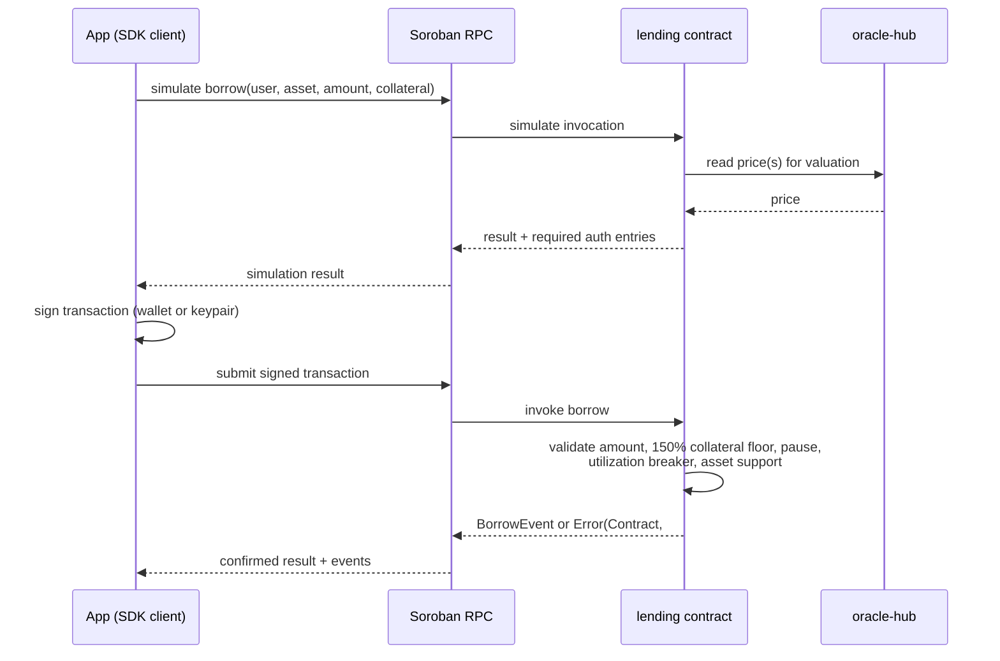
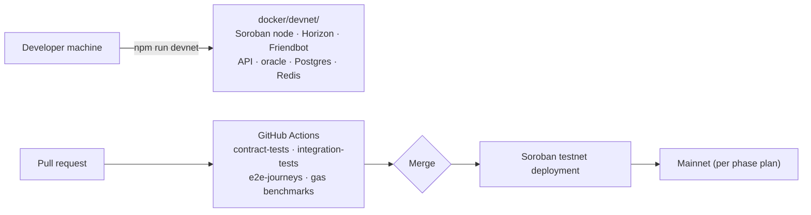

# Architecture Diagrams

Visual overview of StellarLend: how the pieces fit together off-chain and
on-chain, how a borrow transaction flows, and how the deployment topology looks.
The diagrams use [Mermaid](https://mermaid.js.org/) and render directly on
GitHub.

The path references below are the source of truth; when a module moves, update
the diagram in the same pull request.

## System context

Notes:

- The oracle service feeds `oracle-hub`, which the lending contract reads for
  valuation; `twap-oracle` provides manipulated-resistant averages. See
  [REALTIME_PRICE_FEED.md](REALTIME_PRICE_FEED.md).
- The SDK is transport-agnostic: servers, bots, and browsers all use the same
  client over a different adapter (see
  [CONTRACT_INTEGRATION.md](CONTRACT_INTEGRATION.md)).

## Contract module map

Contracts live under `stellar-lend/contracts/` (separate workspace) and grouped
by concern. The root `contracts/` directory additionally hosts governance,
proposal, and timelock contracts plus EVM/Solidity experiments.

The clusters are organizational, not dependency claims; each contract's own
`Cargo.toml` and the [MODULAR_ARCHITECTURE.md](../stellar-lend/contracts/MODULAR_ARCHITECTURE.md)
note state what depends on what.

## Borrow lifecycle (sequence)

The failure points map to contract error codes documented in
[TROUBLESHOOTING.md](TROUBLESHOOTING.md#contract-errors).

## Deployment topology

- `docker/devnet` is a full local network, including seeded accounts and
  liquidation scenarios ([docker/devnet/README.md](../docker/devnet/README.md)).
- CI runs the contract suites and journey tests; check names are listed in the
  workflows under `.github/workflows/`.

## Keeping these current

These diagrams are part of the documentation review surface: a PR that adds,
removes, or renames a module under `stellar-lend/contracts/` or changes the
deployment topology should update this file. Diagrams are reviewed like any
other documentation change.
